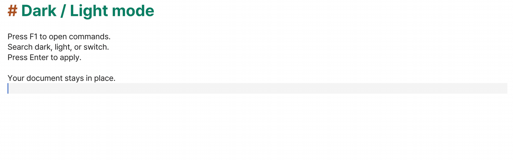

[](https://insights.linuxfoundation.org/project/thorvg/repository/thorvg_thorvg.note)
[](LICENSE)
[](https://en.wikipedia.org/wiki/Thor_Vector_Graphics)
[](https://discord.gg/n25xj6J6HM)
[](https://opencollective.com/thorvg)

# ThorNote

<p align="center">
  
</p>

<h3 align="center">A lightweight, native text editor powered by ThorVG</h3>

ThorNote is designed for everyday writing and note-taking, combining a minimal interface with Markdown editing, flexible layouts, and animated emoji. It supports multiple documents, international text input (IME), and automatic recovery of unsaved work.

Built on [ThorVG](https://github.com/thorvg/thorvg), ThorNote demonstrates how ThorVG can power a complete native desktop application.

## Features

### Markdown Editing

Write and edit Markdown directly, with support for headings, emphasis, links, code, and interactive task lists.


### Motion Emoji

Bring your text to life with animated emoji. Type `:` followed by part of an emoji name and select a match.</br>
Emoji animate inline while remaining compatible with standard Unicode text.


### Layout Modes

Choose between two layouts to suit your workflow:

- **Memo** — Keep multiple documents organized in tabs.
- **Note** — Browse and organize documents using sidebars.


### Light & Dark Themes

Switch seamlessly between light and dark themes through the command palette.



### Additional Features

- **Multi-document Editing** — Work with multiple documents within a single application.
- **Command Palette** — Quickly access commands, themes, and layout settings.
- **International Text Input** — Write in multiple languages with IME support.
- **Session Recovery** — Recover unsaved work.

## Build & Installation

### Requirements

- C/C++ toolchain with C++20 support
- Meson 1.2+
- Ninja
- pkg-config
- Python 3
- [ThorVG](https://github.com/thorvg/thorvg) 1.2+ (CPU and GL renderers, and TTF loader)
- [SDL3](https://github.com/libsdl-org/SDL) 3.2+
- Lua 5.4+ (automatically downloaded if unavailable)

ThorVG and SDL3 must be installed before building ThorNote.

### Build and Run

```sh
meson setup build
meson compile -C build
build/src/thornote/ThorNote notes.txt
```

#### Linux

Installs ThorNote along with its desktop launcher and application icon.

#### macOS

Installs `/Applications/ThorNote.app`, including its application icon, fonts, and layouts. The application bundle is locally signed for execution on the build machine.

ThorVG and SDL3 must remain installed. The `ThorNote` and `tnote` commands are also installed into the configured prefix.

## License

### Third-party Assets

The [Animated Noto Emoji](https://googlefonts.github.io/noto-emoji-animation/) assets are copyright Google LLC and licensed under [CC BY 4.0](https://creativecommons.org/licenses/by/4.0/).
