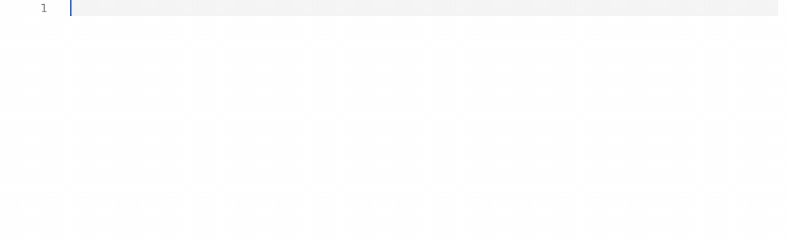
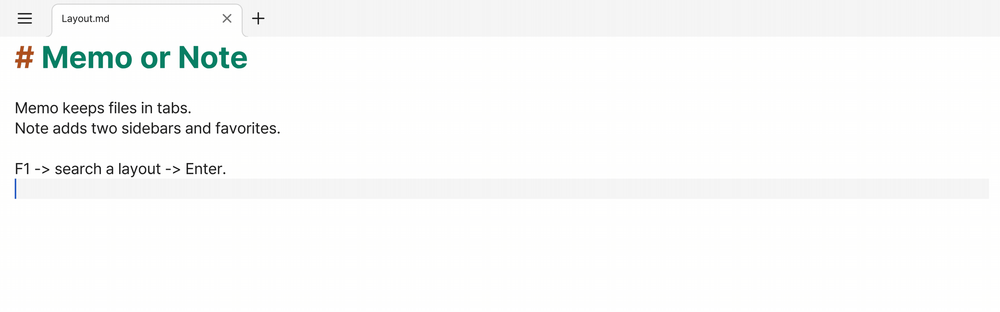
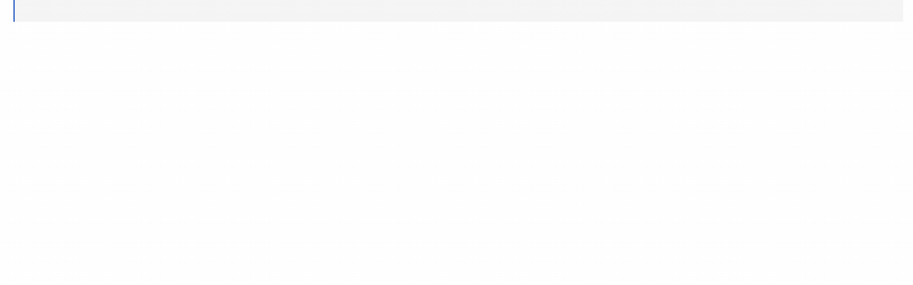

# ThorNote

<p align="center">
  
</p>

A native plain-text editor rendered with ThorVG. Includes multiple documents, configurable layouts, IME input and recovery of unsaved work.

## Feature

### Markdown



Edit headings, emphasis, links and code directly in the Markdown source.

### Dark and light modes


Open the command palette, then choose a dark or light theme.

### Layouts



Use Memo to keep documents in tabs or Note to browse them in two sidebars.
Switch layouts from the command palette.

### Motion emoji



Type `:` and part of an emoji name, then select a match. The emoji animates inline and copies as standard Unicode.


## Build and run

Requires a C/C++20 toolchain, Meson 1.2+, Ninja, pkg-config, Python 3, ThorVG 1.2+ (GL and CPU renderers and the TTF loader) and SDL3 3.2+. ThorVG and SDL3 must be installed. Lua 5.4+ is used when available; otherwise Meson downloads it.

```sh
meson setup build
meson compile -C build
meson test -C build --print-errorlogs
build/src/thornote/ThorNote notes.txt
```

Use `build/` for all builds. ThorNote, its libraries and Lua support are always included. Desktop builds also include tests.

On Linux, `meson install -C build` installs ThorNote with its desktop launcher and icon.

On macOS, `meson install -C build` also installs `/Applications/ThorNote.app`, including its icon, fonts and layouts. The bundle is signed locally for running on the build machine; ThorVG and SDL3 must remain installed. The `ThorNote` and `tnote` commands are installed into the configured prefix as well.

## License

The [Animated Noto Emoji](https://googlefonts.github.io/noto-emoji-animation/) assets are copyright Google LLC and licensed under [CC BY 4.0](https://creativecommons.org/licenses/by/4.0/). ThorNote uses them unmodified. [Asset credits](src/thornote/data/assets/AnimatedEmoji.LICENSE).
